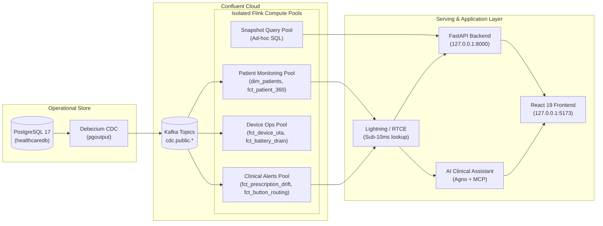

# Streamhouse Healthcare Demonstration

A demonstration of real-time patient health monitoring, clinical alerting, and medical device operations built on the **Streamhouse** architecture:
**Operational PostgreSQL (CDC) -> Apache Kafka & Schema Registry -> Apache Flink (via dbt) -> Serving (Snapshot queries, Lightning / RTCE, AI Assistant, CEP) -> Governance & Lineage.**

---

## Architecture Overview



---

## Quickstart

### Prerequisites
- Python 3.11+ and `uv`
- Node.js 20+ and `npm`
- Terraform 1.5+
- Apple `container` CLI or `docker`

### 1. Set up Infrastructure
```bash
cd IaC/ccloud
cp terraform.tfvars.example terraform.tfvars
# Fill in your Confluent Cloud credentials
terraform init && terraform apply
```

### 2. Configure Environment
```bash
source scripts/set_env_from_tf.sh
```

### 3. Start Local Database & CDC
```bash
./IaC/local/start_local_pg_server.sh --seed
./IaC/local/start_debezium.sh
```

### 4. Deploy Flink Data Products
```bash
cd pipelines
uv sync
dbt seed
dbt run --select +patient_monitoring.facts
dbt run --select +clinical_alerts.facts
dbt run --select +device_ops.facts
```

### 5. Enable RTCE & Start Web Application
```bash
cd IaC/rtce
terraform init && terraform apply
cd ../..
./scripts/run_dev.sh
```

---

## Documentation
Full documentation and numbered scenario walk-throughs are available in `docs/`:
- `docs/index.md` — Overview & architecture
- `docs/demo_brief.md` — Complete domain brief
- `docs/web_app_design.md` — Backend and frontend design
- `docs/flink_deployment.md` — Flink SQL models and dbt integration
- `docs/local_cdc.md` — PostgreSQL and Debezium CDC setup
- `docs/demo_script.md` — Step-by-step presentation script
