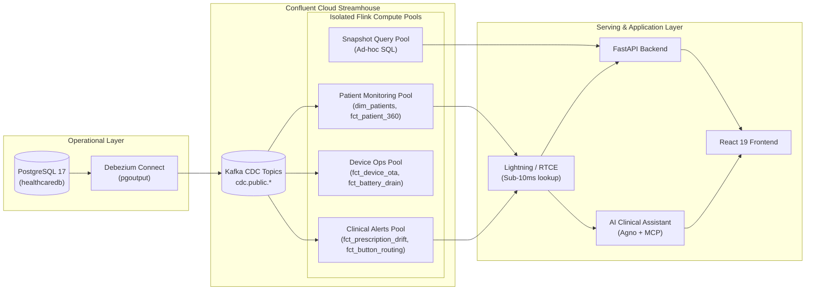

# Streamhouse Healthcare Demonstration

## Purpose and Value Proposition

Modern healthcare providers require immediate synchronization of patient vital signs, clinical target prescriptions, and emergency alerts across all consuming systems. Traditional batch synchronization creates dangerous stale windows where clinical dashboards and nursing stations view outdated vital stats or miss vital anomaly trends.

The **Streamhouse Healthcare Demonstration** showcases an end-to-end, event-driven healthcare streaming architecture built with **PostgreSQL CDC, Apache Kafka, Confluent Schema Registry, Apache Flink SQL (via dbt), and the Real-Time Context Engine (RTCE / Lightning)**.



---

## Capabilities Demonstrated

1. **Hybrid Ingestion (CDC)**:
   PostgreSQL 17 logical replication captures operational CRUD events on `patients`, `care_areas`, `devices`, `device_assignments`, `prescriptions`, and `telemetry_events` into schema-validated Avro topics.
2. **dbt-Driven Flink SQL**:
   Declarative streaming pipeline management with `dbt-confluent` structuring models into `sources/`, `dimensions/`, and `facts/`.
3. **Compute Pool Resource Isolation**:
   Independent Flink compute pools for `patient_monitoring`, `clinical_alerts`, and `device_ops`, guaranteeing dedicated CFUs and failure domain isolation.
4. **Lateral Snapshot Joins on Reference Data**:
   Enrichment of high-throughput telemetry streams against slow-moving seeded clinical reference tables (`ref_vital_guidelines`, `ref_device_models`).
5. **Sub-10ms Point Lookups (Lightning / RTCE)**:
   Low-latency point lookups on compacted golden records (`fct_patient_360`) without spinning up ad-hoc Flink statements.
6. **Complex Event Processing (CEP)**:
   Flink SQL `MATCH_RECOGNIZE` detecting vital anomaly streaks, emergency button escalation, and geofence departures.
7. **AI Clinical Assistant**:
   Natural language agent (Agno + Context Engine MCP) querying live patient states with zero hallucination from stale cache.
8. **Live Lineage & Cost Governance**:
   Interactive streaming DAG with real-time compute pool CFU monthly cost tracking.

---

## Project Structure

```
streamhouse_healthcare/
├── AGENTS.md                 # Agent & developer guardrails
├── README.md                 # Project quickstart
├── mkdocs.yml                # Documentation configuration
├── docs/                     # Full architecture and demo guides
├── IaC/
│   ├── ccloud/               # Confluent Cloud Terraform stack
│   ├── rtce/                 # RTCE Global Key and topic bindings
│   └── local/                # Local Postgres and Debezium scripts
├── pipelines/                # dbt Flink streaming project
├── apps/
│   ├── backend/              # FastAPI vertical slices + analytics + chat
│   └── frontend/             # React 19 + Vite web application
└── scripts/                  # set_env_from_tf.sh, run_dev.sh, stop_dev.sh
```
