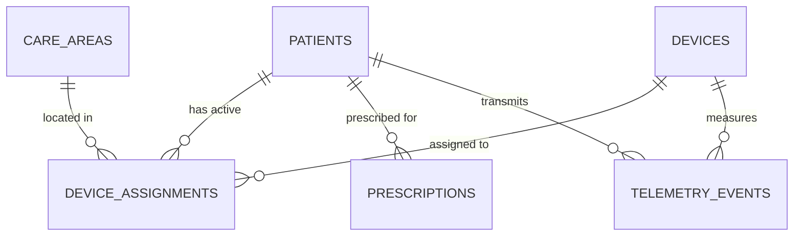

# Web Application Architecture & Design

The Streamhouse Healthcare demonstration is driven by a full-stack application featuring a **FastAPI backend** (Python 3.12, `uv`) and a **React 19 single-page application** (Vite, TypeScript, React Router 7).

---

## Backend Vertical Slices

The backend under `apps/backend/` is partitioned into modular vertical slices:

| Slice / Module | Responsibility | Key Endpoints |
|---|---|---|
| `patients` | Patient demographics, condition, and risk tier | `GET/POST /api/v1/patients`, `GET/PUT/DELETE /api/v1/patients/{id}` |
| `care_areas` | Ward names, facility types, and GPS geofence radius | `GET/POST /api/v1/care-areas`, `GET/PUT/DELETE /api/v1/care-areas/{id}` |
| `devices` | Medical IoT devices, model IDs, firmware, and battery | `GET/POST /api/v1/devices`, `GET/PUT/DELETE /api/v1/devices/{id}` |
| `device_assignments` | Active patient-to-device-to-ward mappings | `GET/POST /api/v1/device-assignments`, `GET/PUT/DELETE /api/v1/device-assignments/{id}` |
| `prescriptions` | Doctor vital metric targets (min/max heart rate) | `GET/POST /api/v1/prescriptions`, `GET/PUT/DELETE /api/v1/prescriptions/{id}` |
| `telemetry_events` | High-frequency vital signs & emergency button alerts | `GET/POST /api/v1/telemetry-events`, `POST /api/v1/telemetry-events/generate` |
| `analytics` | Latency benchmark (Lightning vs. Snapshot) | `GET /api/v1/analytics/benchmark/{id}`, `GET /api/v1/analytics/vitals-summary` |
| `chat` | RTCE Context Engine clinical triage assistant | `GET /api/v1/chat/welcome`, `POST /api/v1/chat`, `POST /api/v1/chat/reset/{id}` |
| `scenarios` | Deterministic CEP trigger runner | `GET /api/v1/scenarios`, `POST /api/v1/scenarios/{id}/run` |
| `data_products` | Statement lineage descriptors and billing CFU costs | `GET /api/v1/data-products`, `GET /api/v1/data-products/billing/costs` |

---

## Database Schema & DDL

PostgreSQL 17 Database: `healthcaredb`  
Logical Replication Publication: `healthcare_cdc_publication`

### Table DDL Summary
1. **`care_areas`**: `care_area_id` (PK), `name`, `facility_type`, `center_lat`, `center_lng`, `radius_meters`, `created_at`, `updated_at`.
2. **`patients`**: `patient_id` (PK), `full_name`, `gender`, `birth_date`, `risk_tier`, `primary_condition`, `status`, `created_at`, `updated_at`.
3. **`devices`**: `device_id` (PK), `model_id`, `serial_number`, `firmware_version`, `battery_pct`, `status`, `created_at`, `updated_at`.
4. **`device_assignments`**: `assignment_id` (PK), `patient_id` (FK), `device_id` (FK), `care_area_id` (FK), `bed_label`, `status`, `created_at`, `updated_at`.
5. **`prescriptions`**: `prescription_id` (PK), `patient_id` (FK), `target_metric`, `min_threshold`, `max_threshold`, `status`, `created_at`, `updated_at`.
6. **`telemetry_events`**: `event_id` (PK), `device_id` (FK), `patient_id` (FK), `event_type`, `heart_rate`, `spo2`, `systolic_bp`, `diastolic_bp`, `lat`, `lng`, `battery_pct`, `button_pressed`, `created_at`, `updated_at`.

---

## Frontend Architecture

- **React 19 + TypeScript + Vite**: Fast modern client with single-page routing via React Router 7.
- **Strict API Layering**: Views call typed functions in `src/api/<domain>.ts` wrapping `request<T>()`. Pages never make raw `fetch()` calls.
- **Statement Lineage DAG**: Rendered via `@xyflow/react` and Dagre graph layout, displaying real-time streaming statement topology and Flink SQL code.
